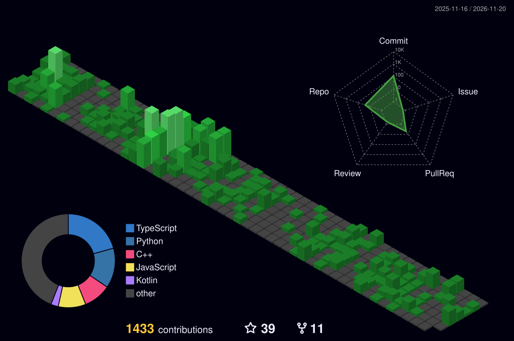
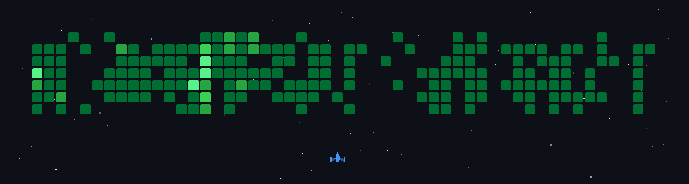

 

  <h2 align="center" style="font-size: 1.65em; font-weight: 400; letter-spacing: -0.01em; line-height: 1.4; margin-top: 10px; margin-bottom: 20px;">
    Greetings From Abhishek's Enchanters 🪄 Your Passport to a World Of Wonder!
  </h2>

  
  
  <!-- Credit: https://www.deviantart.com/dokitsu/art/Kuro-s-the-black-wizard-Mazgeon-605238839 -->
  
  
  

<h1 align="center">Hi There! &nbsp;&nbsp;&nbsp;I'm </h1>

<h3 align="center"><strong>A Passionate Developer from India </strong></h3>

  

> *"Not all treasure is silver and gold, mate."* — Captain Jack Sparrow 🏴‍☠️

- 🔭 I’m currently working on **getnook.me** & building open-source systems
- 💬 Ask me about **JavaScript, Next.js, Python, C++**
- 📫 Reach me at **abhi120730@gmail.com**
- 🌐 Portfolio: **https://www.abhishekworks.com/**

  &nbsp;&nbsp;&nbsp;&nbsp;&nbsp;&nbsp;&nbsp;&nbsp;&nbsp;&nbsp;&nbsp;&nbsp;&nbsp;&nbsp;&nbsp;&nbsp;&nbsp;&nbsp;&nbsp;&nbsp;&nbsp;&nbsp;&nbsp;&nbsp;&nbsp;&nbsp;&nbsp;&nbsp;&nbsp;&nbsp;&nbsp;&nbsp;
  &nbsp;&nbsp;&nbsp;&nbsp;&nbsp;&nbsp;&nbsp;&nbsp;&nbsp;&nbsp;&nbsp;&nbsp;&nbsp;&nbsp;&nbsp;&nbsp;&nbsp;&nbsp;&nbsp;&nbsp;&nbsp;&nbsp;&nbsp;&nbsp;&nbsp;&nbsp;&nbsp;&nbsp;&nbsp;&nbsp;&nbsp;&nbsp;
  

  <h2 align="center"><strong>Socials &amp; Contact 💻</strong></h2>
    

  
  
  
  

  

  <h2 align="center"><strong>Languages, Tools and Technologies 🚀</strong></h2>
   
  <table>
    <tr>
      <td><strong>Programming Languages</strong></td>
      <td></td>
    </tr>
    <tr>
      <td><strong>Frontend Development</strong></td>
      <td></td>
    </tr>
    <tr>
      <td><strong>Backend Development</strong></td>
      <td></td>
    </tr>
    <tr>
      <td><strong>Database Technologies</strong></td>
      <td></td>
    </tr>
    <tr>
      <td><strong>Frameworks</strong></td>
      <td></td>
    </tr>
    <tr>
      <td><strong>Cloud Deployment</strong></td>
      <td></td>
    </tr>
    <tr>
      <td><strong>Hosting Services</strong></td>
      <td></td>
    </tr>
    <tr>
      <td><strong>Developer Tools</strong></td>
      <td>
        
        
      </td>
    </tr>
    <tr>
      <td><strong>Debugging Tools</strong></td>
      <td>
         &nbsp;
         &nbsp;
         &nbsp;
         &nbsp;
         &nbsp;
        
      </td>
    </tr>
    <tr>
      <td><strong>Collaboration Platforms</strong></td>
      <td>
        
        
      </td>
    </tr>
    <tr>
      <td><strong>Operating System</strong></td>
      <td>
        
        
      </td>
    </tr>
  </table>

  

 
 

  <h3 align="center"><strong>GitHub Analytics ⚙️</strong></h3>
   

  <markdown-accessiblity-table data-catalyst="">
    <table style="width: 100%; background-color: #1e1e1e; color: white; table-layout: fixed;">
      <thead>
        <tr>
          <th colspan="2" align="center">
            
          </th>
        </tr>
        <tr>
          <th style="padding: 20px; text-align: center;">
            
          </th>
          <th style="padding: 20px; text-align: center;">
            
          </th>
        </tr>
      </thead>
      <tbody>
        <tr>
          <td colspan="2" align="center">
             
            

              
            

          </td>
        </tr>
      </tbody>
    </table>
  </markdown-accessiblity-table>

